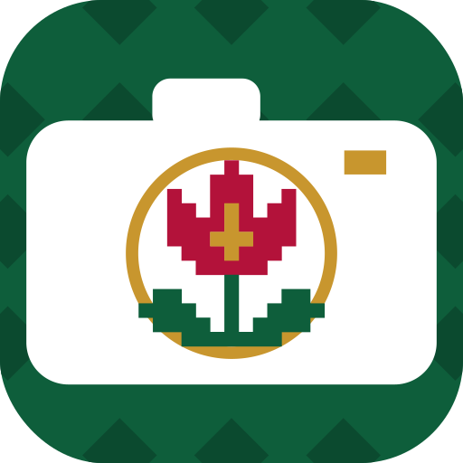
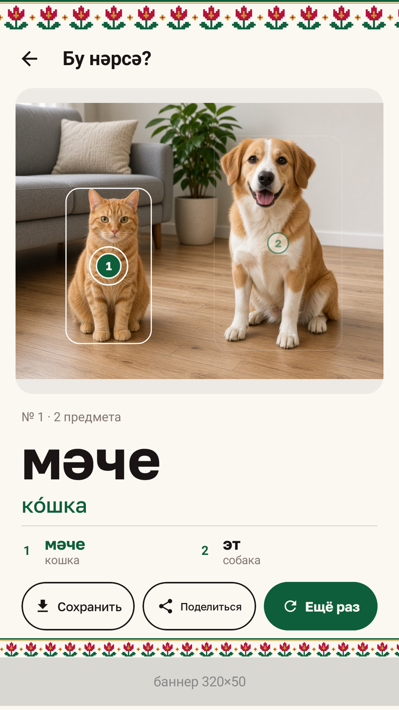
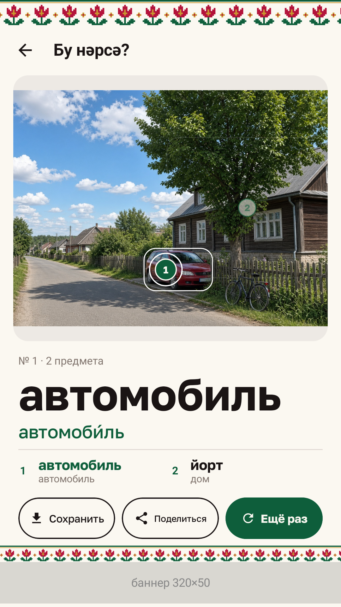
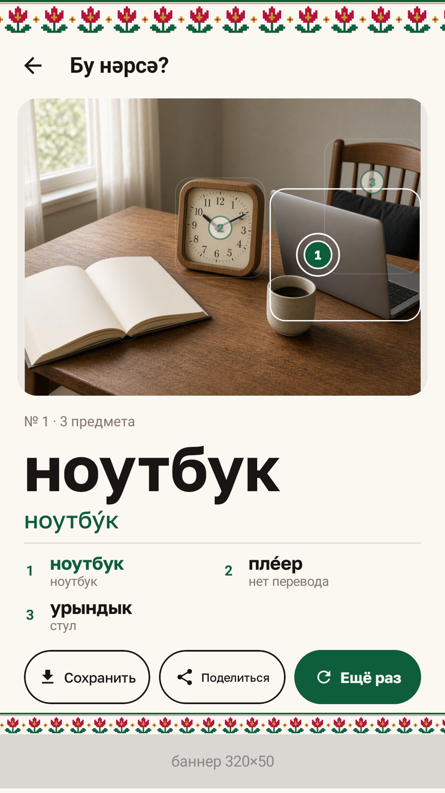
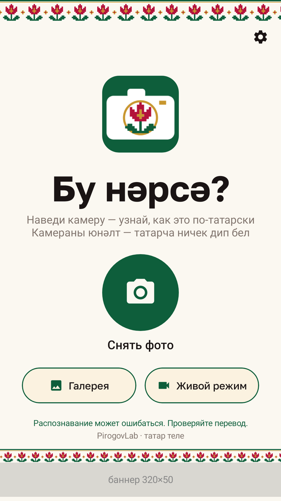

# Бу нәрсә? — татарский словарь по камере

**RU.** Бесплатное Android-приложение: наведите камеру на предмет — и узнайте, как он называется по-татарски (татарча). Татарское слово, русский перевод с ударением и толкование. Распознавание работает офлайн, на телефоне.

**TT.** Бушлай Android-кушымта: камераны әйбергә юнәлтегез — аның татарча ничек аталганын белерсез. Интернетсыз эшли.

- Сайт: https://pirogovlab.ru/bu-narsa/
- Google Play: https://play.google.com/store/apps/details?id=ru.pirogovlab.tatarkamera
- APK: https://pirogovlab.ru/dl/bu-narsa-0.1.0.apk (а также в [Releases](https://github.com/MihailPirogov/bu-narsa/releases))
- Политика конфиденциальности: https://pirogovlab.ru/bu-narsa/privacy/
- Google Play: скоро

   

## Возможности
- Сотни предметов: люди, животные и птицы, посуда, мебель, одежда, транспорт, фрукты и овощи, деревья, небо, вода; до 8 предметов на фото.
- Живой режим (подписи в видоискателе), фото из галереи, сохранение и отправка картинки с подписями.
- Буквы ә ө ү җ ң һ крупным шрифтом; татарский орнамент (тюльпан).
- Без интернета: фото никуда не отправляются. Реклама — Рекламная сеть Яндекса.

## Устройство
- Kotlin + Jetpack Compose, CameraX. Распознавание на устройстве: YOLOv8s Open Images V7 (601 класс), EfficientDet-Lite0 COCO, ML Kit, ImageNet-классификатор, сегментация ADE20K.
- Словарь: `app/src/main/assets/dictionary.json` (`lang: "tt"`), сборка — `dictionary/tt/build_tt.py`, проверка — `dictionary/tt/tt_check.csv`, сомнительные — `dictionary/tt/DOUBTFUL.md`.
- Основано на марийской версии «Мо тиде?» (PirogovLab).

## Сборка
JDK 17, Android SDK 36: `gradle assembleDebug`. Release: `release/keys/keystore.properties` (не в репозитории) → `gradle bundleRelease assembleRelease`.

## Лицензии
- Код — MIT (см. LICENSE).
- Словарь (`dictionary.json`, `dictionary/tt/*`) — данные Викисловаря и Википедии/Викиданных, **CC BY-SA 4.0**.
- Модели: YOLOv8 (Ultralytics, AGPL-3.0), модели TensorFlow Lite (Apache-2.0), ML Kit (Google, условия Google). Шрифт Golos (OFL).

Проект лаборатории [PirogovLab](https://pirogovlab.ru), разработчик — Михаил Пирогов. Ошибка в слове? Откройте issue.
